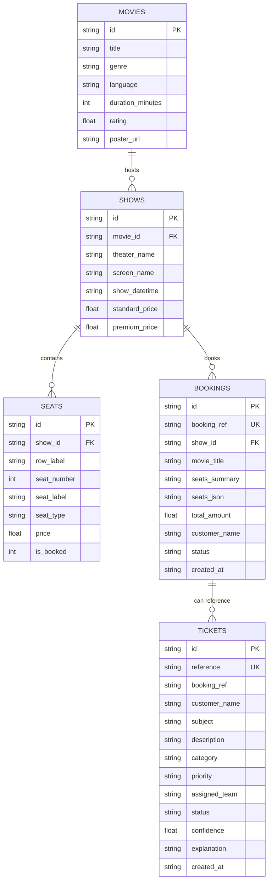

# SmartTheater — Review 4 Academic Prototype

**Project Title:** SmartTheater: Intelligent Movie Booking and Automated Support Ticket Triage and Routing System  
**Review Presentation:** Review 4  
**Implementation Mode:** Independent Academic Prototype (Standalone Demonstration)  

---

## 1. Prototype Objective and Scope

This prototype is a lightweight, fully functional demonstration created specifically for the **Review 4 Academic Evaluation**. It demonstrates the two primary technical pillars of the SmartTheater project:

1. **Intelligent Movie Booking Flow:**
   - Interactive movie selection, showtime filtering, hall layout rendering with Standard and Premium recliner tiers.
   - **Atomic Concurrency Protection:** Real-time seat reservation ensuring no double-booking occurs even under rapid concurrent attempts (returns `HTTP 409 Conflict`).
   - Digital Boarding Pass Ticket generation with unique alphanumeric reference (`ST-YYMMDD-XXXX`) and boarding QR code.
   - Honest academic presentation as a **Demo Reservation** without simulated fake payment gateways.

2. **Automated Support Ticket Triage and Routing Engine:**
   - Centralized customer support interface with 1-click test scenarios for review examiners.
   - **Explainable Rule-Based Classification:** Backend natural language keyword tokenization and rule matching that evaluates ticket subjects and descriptions.
   - Automatically determines **Category** (`Payment`, `Booking`, `Technical`, `General`), **Priority** (`High`, `Medium`, `Low`), **Assigned Team** (`Billing Team`, `Booking Support`, `Technical Support`, `Customer Support`), and calculated confidence score.
   - **Admin Ticket Dashboard:** Live triage queue with real-time status management (`Open`, `In Progress`, `Resolved`) persisted directly to persistent SQLite storage.

> **Integrity Note:** This prototype was built in an independent folder (`review 4 prototype`) and does **not** alter, overwrite, or mutate the main SmartTheater project files.

---

## 2. Technologies Used & Architectural Justification

| Layer | Technology | Version | Justification |
| :--- | :--- | :--- | :--- |
| **Frontend Framework** | React + Vite | React 19 / Vite 8 | Ultra-fast Hot Module Replacement (HMR), component-driven UI, zero build bloat. |
| **Routing** | React Router DOM | v7 | Declarative multi-page routing (`/`, `/seats/:showId`, `/confirmation/:id`, `/support`, `/admin`). |
| **Styling** | Modern Vanilla CSS | CSS3 Variables | Cinema dark palette (`#0a0e17`), glassmorphism, responsive flex/grid layouts without Tailwind dependencies. |
| **Icons** | Lucide React | v1.16 | Lightweight SVG iconography for cinema, seats, badges, and status cues. |
| **Backend Runtime** | Node.js | v22.14.0 | High performance, non-blocking asynchronous event loop with native modern JavaScript support. |
| **Web Server** | Express.js | v4.21 | Minimalist, predictable REST API design with modular routing and controllers. |
| **Database** | Native SQLite (`node:sqlite`) | Built-in (Node 22) | Zero external native compilation binary dependencies on Windows; ACID-compliant WAL persistence. |
| **Classification Engine** | Explainable Rule-Based NLP | Modular Service | Explainable token matching with fallback scoring; easily swappable with ML models (Scikit-Learn/PyTorch). |

---

## 3. Folder Structure

```
review 4 prototype/
├── backend/
│   ├── controllers/
│   │   ├── bookingController.js    # Validates input, coordinates atomic booking, returns ticket
│   │   ├── movieController.js      # Serves movie catalogue and associated shows
│   │   ├── showController.js       # Serves show-specific seating grid & metadata
│   │   └── ticketController.js     # Validates, classifies, saves, and updates support tickets
│   ├── database/
│   │   ├── db.js                   # Node:sqlite connection manager with WAL mode enabled
│   │   ├── seed.js                 # Idempotent database schema migration and sample data
│   │   └── smarttheater_review4.db # Persistent SQLite binary storage file
│   ├── routes/
│   │   ├── bookingRoutes.js        # POST /api/bookings, GET /api/bookings/:id
│   │   ├── movieRoutes.js          # GET /api/movies, GET /api/movies/:id
│   │   ├── showRoutes.js           # GET /api/shows/:showId/seats
│   │   └── ticketRoutes.js         # POST /api/tickets, GET /api/tickets, PATCH /api/tickets/:id
│   ├── services/
│   │   ├── bookingService.js       # Transactional seat locking and pricing computation
│   │   └── triageService.js        # Rule-based text tokenization, scoring, and routing
│   ├── package.json
│   └── server.js                   # Main Express application entry point (Port 5000)
├── frontend/
│   ├── public/
│   │   └── images/                 # Movie poster assets (Last Orbit, Velocity, Kyoto, Wild Within)
│   ├── src/
│   │   ├── components/
│   │   │   ├── BookingStepper.jsx  # 3-step visual progress bar (Movie -> Seats -> Pass)
│   │   │   ├── Footer.jsx          # Academic prototype disclaimer & navigation footer
│   │   │   └── Navbar.jsx          # Top navigation with live backend connectivity indicator
│   │   ├── pages/
│   │   │   ├── AdminDashboardPage.jsx      # Ticket queue, KPI cards, status changer dropdown
│   │   │   ├── BookingConfirmationPage.jsx # Digital boarding pass, QR visual, demo notice
│   │   │   ├── MovieListingPage.jsx        # Film cards, showtime chips, synopsis, ratings
│   │   │   ├── SeatSelectionPage.jsx       # Interactive hall layout, price calculator, conflict check
│   │   │   └── SupportTicketPage.jsx       # Ticket submission form, preset demo test buttons
│   │   ├── services/
│   │   │   └── api.js              # Centralized fetch wrapper for backend REST endpoints
│   │   ├── styles/
│   │   │   └── index.css           # Curated cinema dark design tokens and component styles
│   │   ├── App.jsx                 # Client-side route declarations
│   │   └── main.jsx                # React root mount point
│   ├── index.html
│   ├── package.json
│   └── vite.config.js              # Dev server configuration with backend proxy
├── test_e2e.js                     # Automated 8-step end-to-end regression test script
├── .env.example
├── .gitignore
└── README.md
```

---

## 4. Prerequisites

- **Operating System:** Windows 10 / 11 (tested and optimized for PowerShell & CMD)
- **Node.js:** v18.0.0 or higher (Node **v22+** recommended for built-in native SQLite)
- **NPM:** v9.0.0 or higher
- **Web Browser:** Google Chrome, Microsoft Edge, or Mozilla Firefox

---

## 5. Startup Instructions (Windows)

Open two separate Windows PowerShell or Command Prompt terminals.

### Terminal 1: Start Backend Server
```powershell
# Navigate into the prototype backend folder
cd "c:\Users\HP\OneDrive\Documents\JP\Engineering\Final Year Project\SmartTheater Final Year Project\review 4 prototype\backend"

# Install backend dependencies (express, cors, dotenv)
npm install

# Start the server (automatically initializes and seeds the SQLite database)
node server.js
```
*Output will confirm:*
```
🎬 SmartTheater Review 4 Prototype Backend Running
📡 URL: http://localhost:5000
🩺 Health: http://localhost:5000/api/health
```

### Terminal 2: Start Frontend Application
```powershell
# Navigate into the prototype frontend folder
cd "c:\Users\HP\OneDrive\Documents\JP\Engineering\Final Year Project\SmartTheater Final Year Project\review 4 prototype\frontend"

# Install frontend dependencies (react, react-router-dom, lucide-react, vite)
npm install

# Launch Vite development server
npm run dev
```
*Output will display:*
```
  VITE v8.3.4  ready in 1100 ms

  ➜  Local:   http://localhost:5175/
```

Open your browser and navigate to: **`http://localhost:5175`** (or `http://localhost:5174` depending on local port availability).

---

## 6. Running Automated Verification Tests

To verify that all 8 critical flows (catalog, seat maps, atomic booking, 409 collision rejection, support triage, and admin updates) are healthy, run:

```powershell
cd "c:\Users\HP\OneDrive\Documents\JP\Engineering\Final Year Project\SmartTheater Final Year Project\review 4 prototype"
node test_e2e.js
```

All 8 tests will execute sequentially and verify SQLite persistence.

---

## 7. REST API Endpoints Specification

| Method | Endpoint | Purpose | Sample Status Codes |
| :--- | :--- | :--- | :--- |
| `GET` | `/api/health` | Service health status check | `200 OK` |
| `GET` | `/api/movies` | Fetch all active movies and showtimes | `200 OK` |
| `GET` | `/api/movies/:id` | Fetch specific movie details | `200 OK`, `404 Not Found` |
| `GET` | `/api/shows/:showId/seats` | Fetch show seating matrix & booked states | `200 OK`, `404 Not Found` |
| `POST` | `/api/bookings` | Validate & reserve seats atomically | `201 Created`, `400 Bad Request`, `409 Conflict` |
| `GET` | `/api/bookings/:id` | Fetch confirmed booking record | `200 OK`, `404 Not Found` |
| `POST` | `/api/tickets` | Classify, triage, route, and save ticket | `201 Created`, `400 Bad Request` |
| `GET` | `/api/tickets` | Retrieve tickets queue with optional status filter | `200 OK` |
| `GET` | `/api/tickets/stats` | Aggregate dashboard KPI metrics | `200 OK` |
| `PATCH` | `/api/tickets/:id` | Update ticket status (`Open`/`In Progress`/`Resolved`) | `200 OK`, `400 Bad Request`, `404 Not Found` |

---

## 8. Database Schema & Relationships

The prototype uses **SQLite** stored persistently in `backend/database/smarttheater_review4.db`.



---

## 9. Automated Ticket Triage & Routing Logic

### Classification Process Flow
1. **Normalization:** Input strings (`subject` + `description`) are converted to lowercase, stripped of punctuation, and split into tokens.
2. **Feature Matching:** Tokens are matched against domain dictionaries:
   - **Payment:** `payment`, `upi`, `deducted`, `charged`, `debit`, `refund`, `money`, `razorpay`, `bank` -> **Billing Team** (`High Priority`)
   - **Booking:** `ticket`, `seat`, `booking`, `reschedule`, `showtime`, `screen`, `cancelled`, `qr code` -> **Booking Support** (`High Priority`)
   - **Technical:** `website`, `freezing`, `error`, `bug`, `hangs`, `crash`, `login`, `exception`, `server` -> **Technical Support** (`Medium Priority`)
   - **General:** `wheelchair`, `parking`, `snack`, `popcorn`, `inquiry`, `clean`, `sound` -> **Customer Support** (`Low Priority`)
3. **Priority Heuristics:** If urgency signals (`urgent`, `emergency`, `immediately`, `asap`) are present, priority escalates.
4. **Explainability Audit:** An explanation sentence detailing the exact matched keywords is generated and saved alongside the ticket, allowing administrators and examiners to inspect why the system made its routing choice.

---

## 10. Student Explanation for Project Examiners

When presenting to your project guide, explain the system architecture in four clear points:

1. **Frontend Presentation Layer (React 19 + Vite):**
   "The client uses React components to provide an intuitive cinema experience. State is managed reactively, calculating prices in real time when seats are clicked. It communicates via asynchronous REST calls to our backend."
2. **Backend Application Layer (Express.js):**
   "The backend acts as the controller and business logic coordinator. It handles input validation, coordinates atomic seat locking, and executes our support ticket classification pipeline."
3. **Data Persistence Layer (Native SQLite):**
   "All records—movies, shows, seats, customer reservations, and support tickets—are persisted in an ACID-compliant SQLite database. Because we use transactions (`BEGIN TRANSACTION ... COMMIT`), two users attempting to book the same seat at the exact same moment cannot cause a collision. The second request is safely rejected with an HTTP 409 Conflict."
4. **Intelligent Triage & Routing Engine:**
   "When a support ticket is filed, our classification service tokenizes the text and scores it against domain keyword distributions. It assigns the ticket directly to the specialized team with an appropriate SLA priority and records the decision reasoning for full auditability."

---

## 11. Current Limitations & Future Roadmap

| Feature | Current Review 4 Status | Future Production Roadmap |
| :--- | :--- | :--- |
| **Payment Gateway** | Demo Reservation (Transparent, honest simulation) | Integration with Razorpay / Stripe Webhooks |
| **Ticket Classification** | Explainable Rule-Based NLP Token Matching | Fine-tuned BERT / DistilBERT text classification model |
| **Authentication** | Demo Admin Dashboard with open access | Role-Based Access Control (RBAC) with JWT & bcrypt |
| **Notifications** | Instant On-Screen Digital Pass | Automated transactional Email & WhatsApp ticket dispatch |
| **Seat Map Scaling** | 120 seats across 10 rows (Standard & Premium) | Dynamic theater SVG editor with wheelchair accessible zones |
